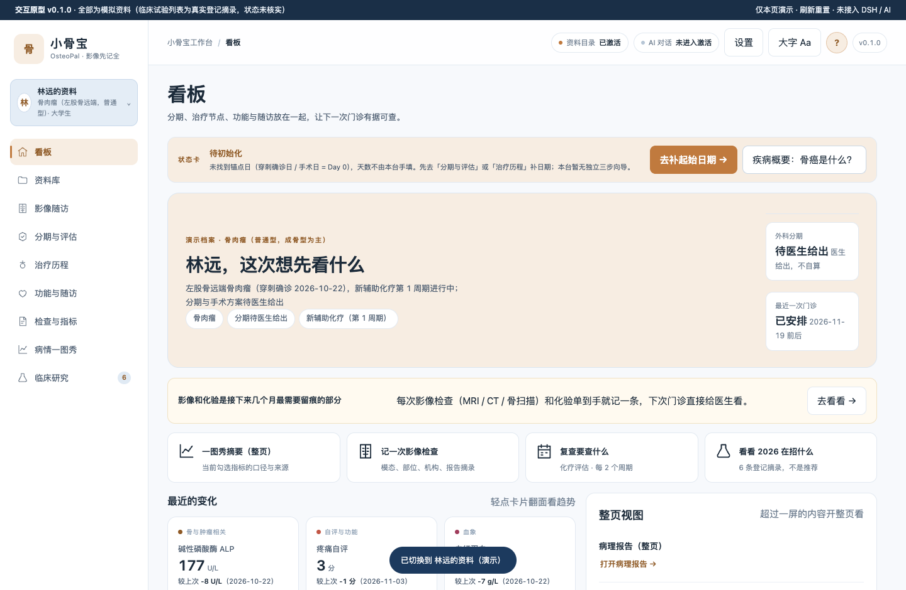
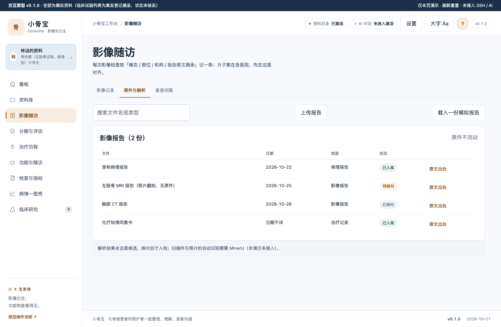
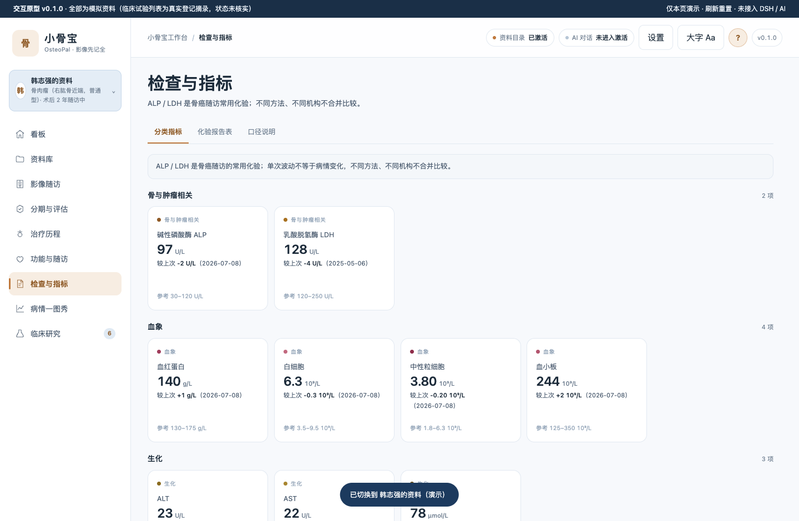
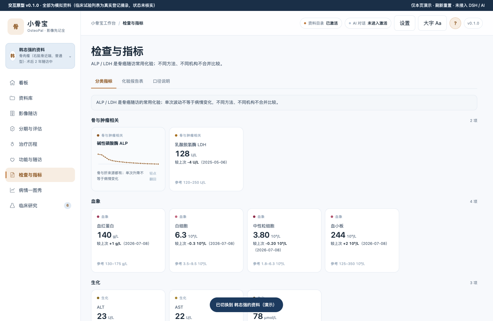
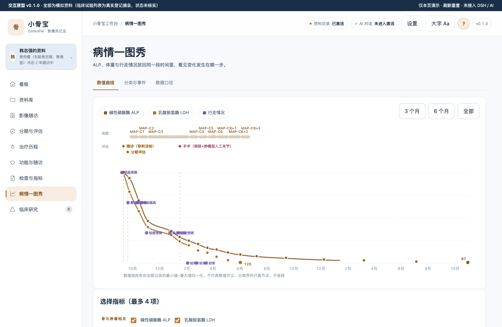
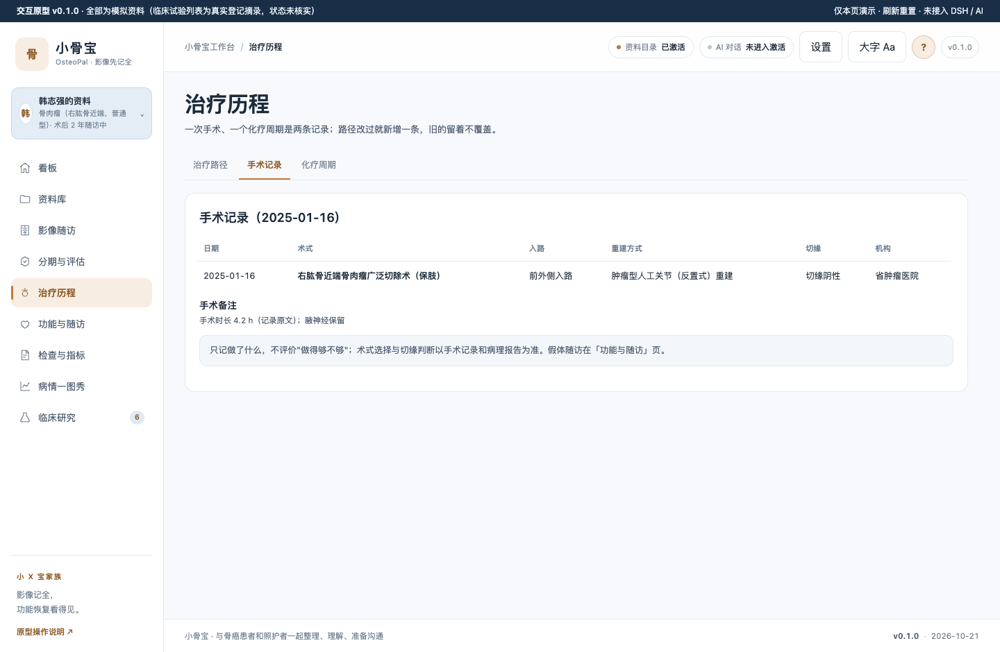
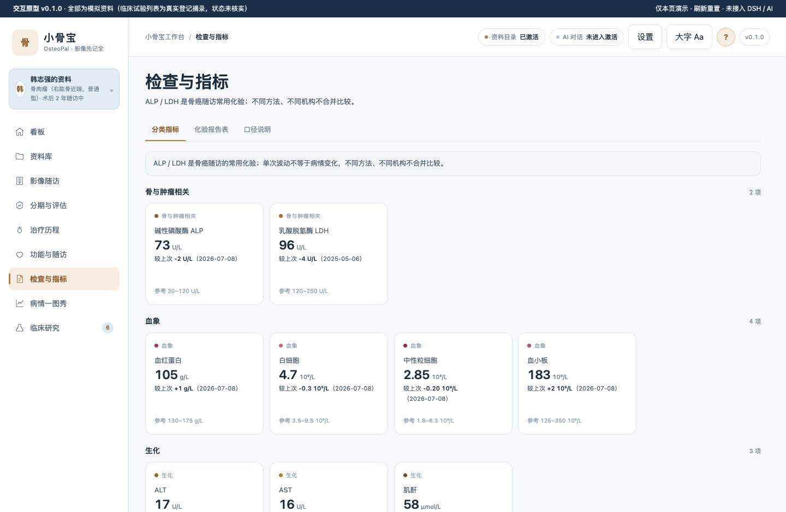

# 小骨宝 OsteoPal · 骨癌工作台

骨原发恶性肿瘤（骨肉瘤 / 软骨肉瘤 / 尤文肉瘤，罕见病 #36 骨巨细胞瘤、#57 骨肉瘤挂靠）患者工作台：影像随访、肢体功能、治疗节点与随访节律整理，仅回顾不解读。**全部患者数据为合成示例；临床试验列表为真实登记摘录（状态未核实）。**

## 疾病概要

### 定义

骨原发恶性肿瘤是起源于骨组织的恶性肿瘤，常见类型有骨肉瘤、软骨肉瘤、尤文肉瘤等；骨巨细胞瘤是原发于骨骼的交界性肿瘤（卫健委 2025 年版指南口径）。确诊靠「临床 + 影像 + 病理」三结合，治疗前必须活检，首选穿刺活检。

### 医学资料规范和指南情况

国家卫健委《86 个罕见病病种诊疗指南（2025 年版）》含骨肉瘤 / 尤文肉瘤 / 骨巨细胞瘤单病种指南；CSCO《骨与软组织肿瘤诊疗指南 2025》；NCCN Bone Cancer 2.2025（现行版本号未核实）。全部只核到「存在」层，全文未取得，版本号不写死。

### 目前治疗全景概要

高级别骨肉瘤的标准路径是「新辅助化疗 → 手术（保肢/截肢）→ 辅助化疗 → 定期随访」，肺转移监测以胸部 CT 为首选口径。以上按病期与线序排列，不代表任何一项适合你；选哪一个需要问你的医生。

### 发展趋势

2025 年卫健委罕见病指南收录；2025 CSCO 骨与软组织指南发布；截至 2026-11-10 CT.gov 中国骨肉瘤登记 87 项（招募中 19 项，API 实测）。只写已发生事实，不做预测。

顶栏「?」打开四段疾病概要整页面板，每段带来源行；概要只做第②层解释，固定出口是「不代表任何一项适合你」「需要问你的医生」。来源分层与版本留痕见 [docs/CLINICAL-DATA.md](docs/CLINICAL-DATA.md)。

## 关键功能（截图墙）

**看板**：状态卡（锚点日派生天数）+ 最近变化 + 下一次门诊三件事，随访前一次看全。

**影像随访**：骨癌随访以影像为核心，模态/部位/机构/报告摘录逐条记录，与化验同看。

**检查与指标**：分类指标卡（ALP/LDH/血象/自评），轻点翻面看趋势；参考区间仅演示值，不做判定。

**病情一图秀**：ALP、体重与行走情况放回同一段时间，看见变化发生在哪一步。

**治疗历程**：一次手术 / 一个化疗周期是两条记录；路径改过就新增，旧的留着不覆盖。

**化验报告表（档案 B）**：化验单按来源展示，与最近报告表同源。

## 怎么用

1. 直接双击打开 `prototypes/v0.2/index.html`（file:// 可用），或本地静态托管后访问。
2. 左上角头像切换两个演示档案：**林远**（19 岁 · 骨肉瘤左股骨远端 · 刚确诊记录少）、**韩志强**（38 岁 · 骨肉瘤右肱骨近端 · 保肢术后 2 年记录多）；切换后整页联动、不串档。
3. 顶栏从左到右：资料目录 → AI 对话（右侧面板，窄/标准/宽）→ 设置 → 大字 → ?（疾病概要）→ 版本。
4. 本原型为演示态：AI 明说「未接入」；上传/解析只做本地演示；数据刷新即重置。

## 数据与口径

- 演示数据唯一源：`demo/build-demo-data.mjs` → `demo/demo-data.sqlite` + `prototypes/v0.2/demo-data.js`；改数据只改生成器。
- 口径：「仅回顾，不解读」「解读归医生」「不同方法不合并」；分类序列（行走情况/疲劳自评）只画节点不连线；数值线各自归一化，不可跨指标比较。
- 隐私三出口（看板摘要 / 导出 / AI 上下文）共用同一过滤函数；感受记录默认私密，「N 条中私密 M 条」同屏。
- 医学阈值全部【待核】；中国适应证只认中国官方来源（见 docs/CLINICAL-DATA.md）。
- **0 患者访谈、0 临床审核**：场景为家族基线推演，如实标注，改写句不冒充引语。

## 开发

- check 链：`npm run check`（含探针覆盖、版本同源、断言强度、底本残留扫描）。
- 探针：`npm run probe:primer`（36 号疾病概要 P1–P9）、`npm run probe:pageview`（32 号整页视图 A1–A10）、`npm run probe:m2`（全量路由 × A/B 档案 56 连拍，产出 docs/shots/m2/report.json）。探针必须带 `--url http://127.0.0.1:<port>/prototypes/v0.2/index.html` 显式指向本仓页面。
- 版本 v0.2（原型）；版本四处同源：package.json / APP_INFO / 页脚 / README 截图文件名。
- 家族结构移植自 cervical-workbench v0.2（客户端链路底本）(leftover-allow:底本声明)，病种语义全部重写；禁词残留 grep 0 命中。
